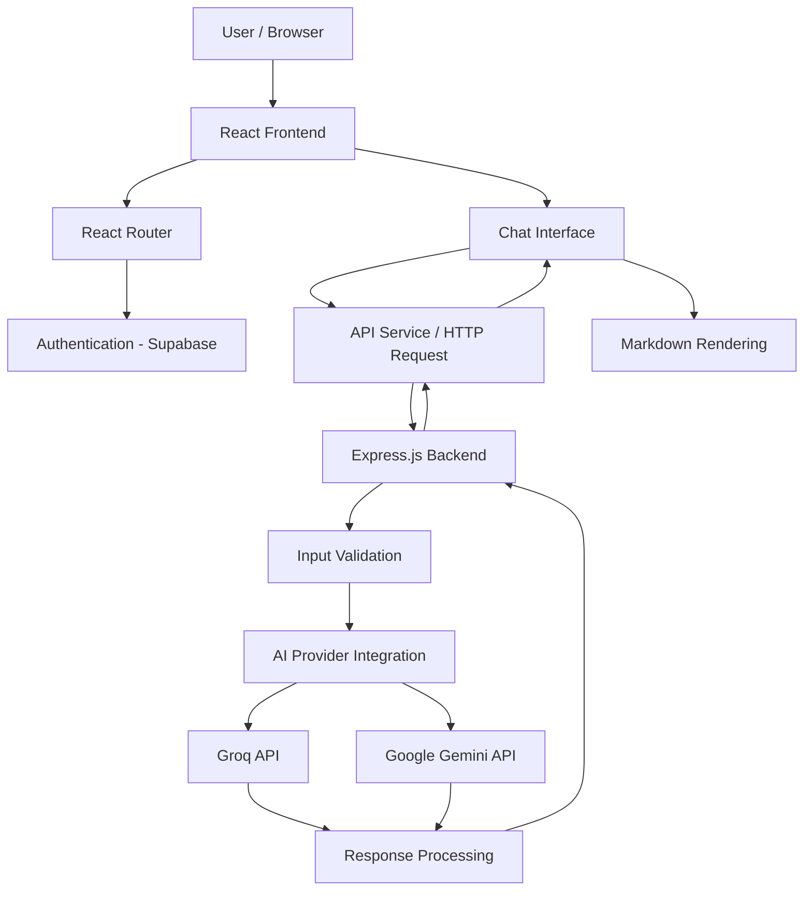

# BrainWave V2 — AI-Powered Full-Stack Web Application

BrainWave V2 is a responsive AI-powered web application built with React, Node.js and Express.js. It integrates third-party AI services with a dedicated backend, providing user authentication, protected application routes and an interactive conversational interface.

The project demonstrates practical full-stack development, REST API integration, asynchronous programming, responsive UI engineering, application debugging and deployment.

**Live Application:** https://brainwave-nine-zeta.vercel.app/

**GitHub Repository:** https://github.com/otizdeavid/brainwave

---

## 1. Technology Stack

| Category | Technologies |
|---|---|
| Frontend | React 18, JavaScript |
| Build Tool | Vite |
| Styling | Tailwind CSS |
| Routing | React Router |
| Backend | Node.js, Express.js |
| Authentication | Supabase Auth |
| Database Platform | Supabase |
| AI Integration | Groq API, Google Gemini API |
| HTTP Communication | REST APIs, JSON |
| Content Rendering | React Markdown, Remark GFM |
| Code Quality | ESLint |
| Version Control | Git, GitHub |
| Frontend Deployment | Vercel |
| Backend Deployment | Render |

## 2. Architectural Design

BrainWave follows a separated frontend and backend architecture. This allows the user interface, application logic and external AI integrations to operate independently.

### High-Level Architecture



### Architectural Responsibilities

**Frontend**
- Handles user interaction and application presentation.
- Manages authentication states and protected navigation.
- Controls chat input, loading states and response rendering.
- Communicates with the backend through HTTP requests.

**Backend**
- Provides dedicated API endpoints.
- Validates incoming requests.
- Handles communication with external AI providers.
- Processes responses and manages API errors and fallback behaviour.
- Keeps third-party AI credentials outside the browser environment.

**Authentication**
- Uses Supabase Authentication for account registration, login and session management.
- Implements protected application navigation to restrict access to authenticated users.

## 3. Application Routing

React Router manages navigation between public and authenticated application areas.

| Route | Purpose | Access |
|---|---|---|
| `/` | Landing page | Public |
| `/signup` | Account registration | Public |
| `/login` | User authentication | Public |
| `/app` | Main application dashboard and chat | Protected |

Protected routing ensures unauthenticated visitors are redirected to the login flow before accessing the private application interface.

Authentication sessions are managed through Supabase.

## 4. REST API and API Integration

The Express.js backend provides an API layer between the React frontend and external AI services.

### API Endpoints

| Method | Endpoint | Description |
|---|---|---|
| GET | `/api/health` | Checks backend availability |
| POST | `/api/chat` | Processes chat requests and communicates with AI providers |

### API Integration Workflow

1. The user submits a message through the React interface.
2. The frontend sends an HTTP POST request containing the message and relevant conversation context.
3. Express receives and validates the request.
4. The backend communicates with the configured AI provider.
5. The provider generates a response.
6. The backend processes the result and returns a JSON response.
7. React updates the chat interface and renders the response using Markdown.

The backend also implements provider fallback handling to improve resilience when an AI service experiences availability or performance issues.

## 5. Asynchronous Programming

JavaScript asynchronous programming is used throughout the application to prevent long-running operations from unnecessarily blocking the user experience.

Implementation includes:

- `async/await` for asynchronous operations.
- Promise-based HTTP communication.
- Asynchronous authentication and session handling.
- API response processing.
- Loading and error states.
- Request timeout handling.
- AI provider fallback mechanisms.

These techniques help manage external service dependencies and improve application responsiveness.

## 6. Responsive UI Development

The frontend uses React and Tailwind CSS to deliver a responsive interface across desktop and mobile devices.

Responsive engineering considerations include:

- Mobile-friendly navigation.
- Flexible application layouts.
- Responsive dashboard and chat interfaces.
- Adaptive sidebar behaviour.
- Consistent spacing and typography.
- Mobile viewport optimisation.
- Horizontal overflow prevention.

Browser DevTools and viewport testing were used to identify and resolve layout issues across different screen sizes.

## 7. Debugging and Problem-Solving

Development involved identifying, diagnosing and resolving issues across multiple application layers.

Key areas addressed include:

- React rendering and component integration issues.
- Authentication redirects and session handling.
- REST API communication failures.
- AI provider availability and rate-limit errors.
- Backend network and request-handling issues.
- Environment-variable configuration.
- Production build and deployment errors.
- Missing frontend assets.
- Mobile layout overflow.

ESLint is used for static code analysis, while Vite provides the production build workflow.

## 8. Key Application Features

- User registration and authentication.
- Google sign-in integration.
- Protected application routes.
- Interactive AI chat interface.
- Conversation management.
- AI-powered response generation.
- Markdown-formatted responses.
- Multiple AI provider integration.
- Backend health monitoring.
- Responsive application interface.

## 9. Project Structure

```text
brainwave/
│
├── brainwave-backend/
│   ├── server.js
│   └── package.json
│
├── public/
│   └── assets/
│
├── src/
│   ├── components/
│   ├── pages/
│   ├── services/
│   ├── assets/
│   └── main.jsx
│
├── index.html
├── package.json
├── vite.config.js
├── tailwind.config.js
├── eslint.config.js
├── vercel.json
└── README.md
```

*The structure above highlights the main application areas; individual component and configuration files are organised within their respective directories.*

## 10. Local Development Setup

### Prerequisites

- Node.js
- npm
- Git
- Supabase project credentials
- AI provider API credentials

### Clone the Repository

```bash
git clone https://github.com/otizdeavid/brainwave.git

cd brainwave
```

### Install Frontend Dependencies

```bash
npm install
```

### Configure Environment Variables

Create a `.env` file in the frontend root and configure the Supabase project URL, public authentication key and backend API URL.

```env
VITE_SUPABASE_URL=your_supabase_url
VITE_SUPABASE_ANON_KEY=your_supabase_public_key
VITE_API_BASE_URL=http://localhost:5000
```

Use the exact environment variable names expected by the application configuration.

### Start the Frontend

```bash
npm run dev
```

### Backend Setup

Navigate to the backend directory:

```bash
cd brainwave-backend
npm install
```

Configure the backend environment variables, including the required AI provider credentials and server configuration.

Start the backend using its configured Node.js entry point.

**Important:** Never expose Groq or Google Gemini secret API keys in frontend environment variables or commit credentials to GitHub.

## 11. Build and Code Quality

Available frontend scripts:

| Command | Purpose |
|---|---|
| `npm run dev` | Starts the development server |
| `npm run build` | Creates a production build |
| `npm run preview` | Previews the production build |
| `npm run lint` | Runs ESLint checks |

Automated unit and end-to-end testing are not currently configured as part of the frontend scripts.

## 12. Deployment

BrainWave uses separate deployment environments for the frontend and backend.

- **Vercel:** Hosts the React frontend and production build.
- **Render:** Hosts the Express.js backend.
- **Supabase:** Provides authentication services.

Environment variables are configured through the respective deployment platforms to separate development configuration from production credentials.

## 13. Engineering Focus

The project demonstrates practical experience in:

- Frontend component development.
- Full-stack application architecture.
- Authentication and protected navigation.
- REST API design and integration.
- Asynchronous JavaScript.
- Third-party service integration.
- Error handling and debugging.
- Responsive web development.
- Git-based version control.
- Production deployment and configuration.

## 14. Future Improvements

Potential areas for further engineering improvements include:

- Automated unit, integration and end-to-end testing.
- Expanded backend authentication and authorisation tests.
- Persistent server-side conversation storage.
- API documentation using Swagger/OpenAPI.
- Improved application logging and monitoring.
- Additional database operations and optimisation.
- CI/CD automation.

## 15. Author

**Victor Sunday**

Full-Stack Developer | React | JavaScript | Node.js | Express.js

GitHub: https://github.com/otizdeavid

---

*BrainWave V2 is a practical full-stack development project built to demonstrate the integration of modern frontend technologies, backend services and external APIs into a functional web application.*
